# Assignment 1: Reinforcement Learning

**Name:** Vincent Yang  
**GitHub username:** vi-yang-NU  
**Repository name:** RL  
**Link to the GitHub repository:** <https://github.com/vi-yang-NU/RL>  

## Instructions for running the code

> Instructions of how to run your code.

Nothing has to be run to grade: every answer, plot, evaluation statistic and validation result is in this
report, and the repository includes the files it was built from (`results/`). The dashboard shows the same
answers next to their plots and test evidence, and reruns any part. To open it, with Python 3.9 or newer on
macOS or Linux (WSL on Windows):

```bash
git clone https://github.com/vi-yang-NU/RL.git && cd RL
./setup.sh --no-ssh        # creates .venv and installs the packages (requirements*.txt)
source .venv/bin/activate
python run.py ui
```

It opens at <http://localhost:8501> (if no browser opens, open that address yourself), with one tab per part
of the handout and, in each, a **Run** panel that reruns that part. The rest of this report follows the
handout's order; the table of contents below lists every section. The same parts run from the terminal
(`python run.py -h` lists the commands; `python run.py tests --section dp`, `pg1` or `pg2` reruns the
validation experiments), and the repository's README covers running on deepdish.

## Contents

- [Instructions for running the code](#instructions-for-running-the-code)
- [2. Value and Policy Iteration (30 points)](#2-value-and-policy-iteration-30-points)
  - [Solution overview](#solution-overview)
  - [MDP formulation](#mdp-formulation)
  - [(a) Enumeration, T = 500](#a-enumeration-t--500)
  - [(b) Value iteration, T = ∞](#b-value-iteration-t--)
  - [(c) Policy iteration](#c-policy-iteration)
  - [Assumptions](#assumptions)
  - [Edge cases](#edge-cases)
  - [Tests for validating the correctness of your algorithm](#tests-for-validating-the-correctness-of-your-algorithm)
  - [Additional validation with 3 more months](#additional-validation-with-3-more-months)
- [3. Policy Gradient: Part 1 (40 points)](#3-policy-gradient-part-1-40-points)
  - [Solution overview](#solution-overview-1)
  - [(a) CartPole-v1, discount factor 0.95](#a-cartpole-v1-discount-factor-095)
  - [(b) Pong-v5, discount factor 0.99](#b-pong-v5-discount-factor-099)
  - [Edge cases](#edge-cases-1)
  - [Tests for validating the correctness of your algorithm](#tests-for-validating-the-correctness-of-your-algorithm-1)
  - [Additional validation with 3 more months](#additional-validation-with-3-more-months-1)
- [Policy Gradient: Part 2 (20 points)](#policy-gradient-part-2-20-points)
  - [Baseline: choice and implementation](#baseline-choice-and-implementation)
  - [Solution overview](#solution-overview-2)
  - [(a) CartPole-v1 with baseline](#a-cartpole-v1-with-baseline)
  - [(b) Pong-v5 with baseline](#b-pong-v5-with-baseline)
  - [Edge cases](#edge-cases-2)
  - [Tests for validating the correctness of your algorithm](#tests-for-validating-the-correctness-of-your-algorithm-2)
  - [Additional validation with 3 more months](#additional-validation-with-3-more-months-2)

## 2. Value and Policy Iteration (30 points)

### Solution overview

> Provide a description of your solution and any corresponding plots.

Thinking from a greedy algorithm perspective, generally speaking we know that it is not worth it for our shuttle to move to the other platform if the cost of moving the shuttle is more than us waiting until that number breaks even. The state is the amount of people waiting at Station A, the action is taking people on the shuttle to station B. Reward is revenue-cost, and random demand is the amount of people arriving at the station. 

In order to map this out, we should try with, explicitly we have 3 different methods we will explore in this Value and Policy iteration section: 
Assume the number of people can't exceed 200, and use discount rate of 0.95 (and additional assumptions will be listed too)

1. Enumeration: backward induction, so we're assuming a Time period = 500,  we start at the last Time step, and apply the bellman backup going backwards 
2. Value iteration: Repeat Bellman on one value table until it converges then read the best policy off the table, time = infinite. 
3. Policy iteration: evaluate and greedy change policy and stop when policy stops changing 

For fun, to have optimal execution of the code, the solvers also have GPU versions, which we checked against the Python ones to make sure they are valid, but will run faster

### MDP formulation

> Model the shuttle dispatching problem as a Markov Decision Process, given K = 15, c_f = 100, c_h = 2 and A_t ~ Unif{1, 2, 3, 4, 5}. The number of people in the station cannot exceed 200; use discount rate γ = 0.95.

Markov Decision Process means 5 things we should define: 1. state 2. action 3. transition 4. cost and 5. objective 
Reward is revenue-cost, and random demand is the amount of people arriving at the station.


1. State: The state is the amount of people that are currently on the platform A
2. Action: the action is taking people on the shuttle to station B
3. Transition: 
      3a. Number of people left on Station A after we transport is max(0, current_size - K). # K is capacity of a shuttle if it is dispatched
      3b. If we don't dispatch shuttle, the amount of people would be current_size, 
      3c. at each timestep its's randomly going to be Unif {1, 2, 3, 4, 5}, so next state is = to min(people left + A_t, 200).
4. Cost: we have two costs in this problem: 1. Dispatching the shuttle will cost 100 per time step, and cost per customer on platform is 2c per timestep incurred after dispatch, with c being customer. 
5. Our objective function is maximizing our reward, which is defined by the revenue - cost, or in this case because we don't have revenue, we just want to minimize our cost over time: min(cost)

### (a) Enumeration, T = 500

> Solve using enumeration (with time period T = 500). Plot the optimal value function at time 0 versus number of customers waiting.

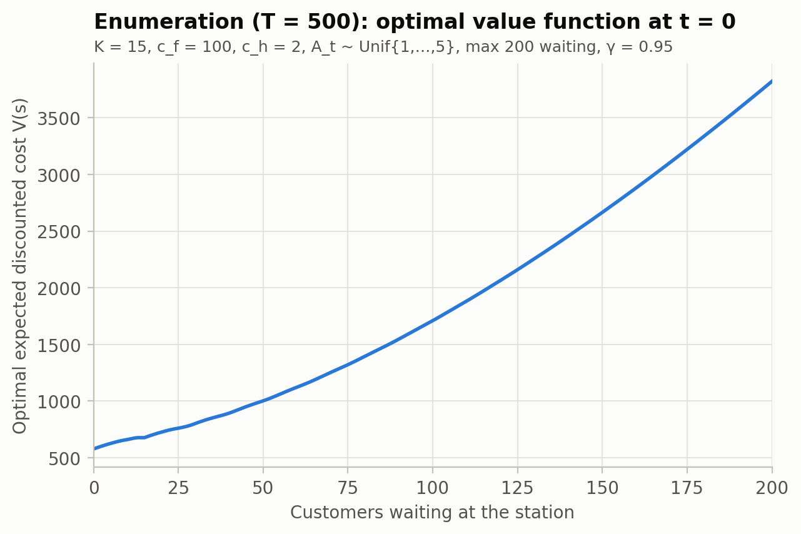

*Figure 1. Section 2 (a), enumeration with T = 500: optimal value function at time 0 versus number of customers waiting.*

In our very last case assume that it will not cost us anything at the last step. Technically speaking because the timestep is so far into the future, making this assumption is fine, that being said its possible to do more work in the future in this regards. 

We performed backwards induction (essentially (dynamic programming) with time = 500 we apply the bellman backup and record the minimizing cost. Within this plot it shows that Essentially by computing it backwards, we know that at timestep for timestep we're computing a table of all the possible people in the station A. 
On the x axis we show the amount of people waiting at Station A when we end at our timestep of 0 (remember as we're starting from 500 and going to 0). Our Y axis shows our expected value at our last timestep.

### (b) Value iteration, T = ∞

> Solve using value iteration (T = ∞). Plot optimal value function versus number of customers waiting.

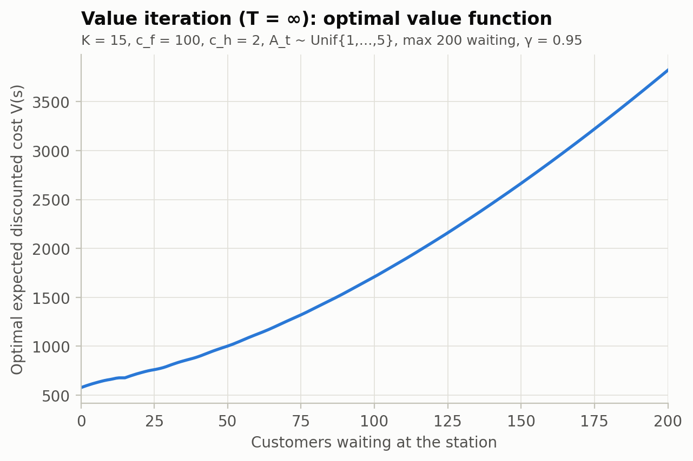

*Figure 2. Section 2 (b), value iteration (T = ∞): optimal value function versus number of customers waiting.*

We start with V(s) = 0 and then for every s value, we apply the Bellman backup and repeat. And thus our convergence criteria is when largest V change across all states is below our condition (which in our case we set it to 10^-6). Due to our discount factor by 0.95, our errors keep shrinking . Value iteration has no timesteps (in comaprison to enumeration) and it's similar to enumeration, however we don't work from our 500 timestep value backwards. We assume to have some sort of convergence criteria, which we'll define to 10^-6, and the discount factor allows us to compare future costs with todays' costs. It converged in 340 steps in comparison to before for our enumeration (since we started at T=500), due to our convergence factor.

### (c) Policy iteration

> Solve using policy iteration. Plot optimal policy versus number of customers waiting.

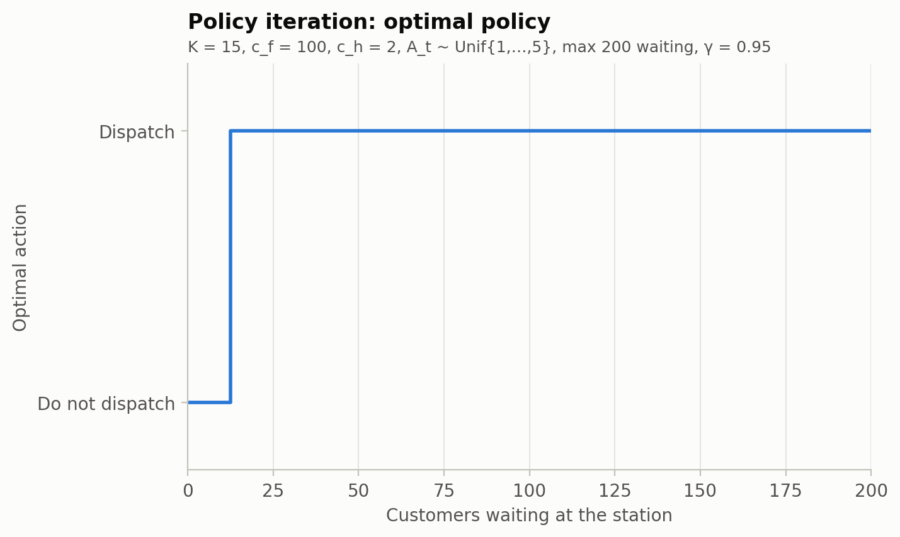

*Figure 3. Section 2 (c), policy iteration: optimal policy versus number of customers waiting.*

In our Policy iteration, we. have two actions: either we dispatch, or we hold in our station A. Policy iteration is also another form of DP problems. When we're looking at every customer s step, essentially because we're keeping track of all possible actions at every customer step we will always be able to solve the optimal strategy at each customer step. Thus essentially we're stepping through all possible 200 states (assume the empty platform s = 0) would be 201 states.  At each state we evaluate two actions: whether we should dispatch or if we should hold. As we can see at the graph above, it makes sense for us to always dispatch when our value >= 13, to create our optimal policy. 

The reason why this is called policy iteration is we then take this information and run it through

### Assumptions

> If you make any other assumption, please state it in your report.

The number of people can't exceed 200, and Discount rate of 0.95

### Edge cases

> What edge cases may arise from the problem and how did you handle them? Document the edge cases of the problem that you considered and explain how you ensured that your solution has handled them correctly.

Edge case 1: Exceeding the number of people on the platform. What would happen if we exceed the number of people we can hold on Platform A, aka if the amount of passengers goes above 200 due to an exponential amount of people coming into the station? 

Edge case 2: There's a lot in this prompt that we can technically break, for example: Unif {1, 2, 3, 4, 5}, assuming a world where, we can think of an example lets say at an arbitrary timestep we have 4 people come in, next time step we have another 4 come in, and then another 4, then we only get 5 in for the next 3 timesteps. What should the optimal policy be in this case? until when do we hold all of the people. 

Edge case 3: Wince it's not possible for us to have 0 or - amount of people that part of the edge case is fine. What if we assume that the original platform has 200 people? and we have 5 people arriving at every timestep. So every number above 200 will be discarded assumingly since we can't go above 200 people. Would it make more sense for us to not dispatch to reduce the amount of cost? would that ever be the case.

### Tests for validating the correctness of your algorithm

> Beyond asking AI, how do you know that your algorithm is working correctly? Test whether your implementation is behaving as predicted. For example, you may change certain parameters or the structure of the problem and see if the output matches your expectation. You may also reduce the stochasticity of the environment or policy so that the process is close to deterministic. You may also find it useful to isolate the first 10 steps and observe how the states, values, rewards, and policy interact at each step. Provide directions and documentation for how to execute validation and test experiments (what does each test do, how does it validate, etc). Provide quantitative and convincing evidence. (Not unit tests or basic bug fixes, such as checking the data format.)

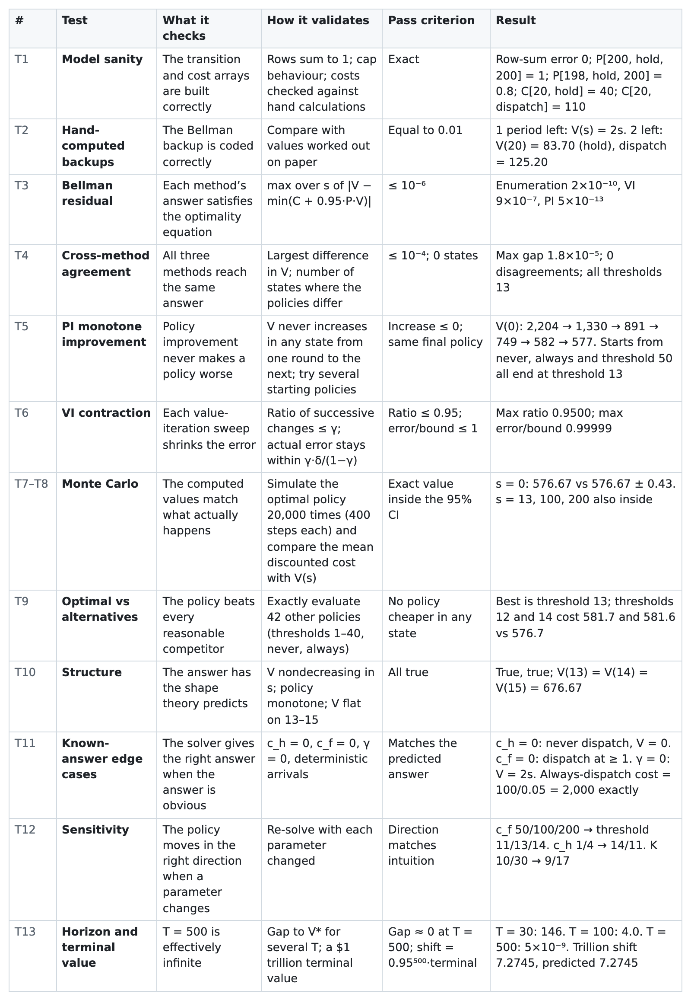

*Figure 4. Section 2, validation: summary of the validation tests T1–T13, with what each one checks, how it validates the solver, its pass criterion and the result observed (the table in report/dp_tests_table.md). The harness's detailed results for each experiment follow.*

Validation results from `python run.py tests --section dp` (last run 2026-10-30 20:01:58 on dhcp-10-105-79-151.wireless.northwestern.private):

| Test | What it does | How it validates | Result |
|---|---|---|---|
| Three solvers, one answer | Solves the handout's problem (K = 15, c_f = 100, c_h = 2, A ~ Unif{1..5}, at most 200 waiting, γ = 0.95) with enumeration over T = 500 periods, value iteration and policy iteration, and compares the three value functions and policies state by state. | The three methods are different algorithms for the same optimality equation, so they must agree: enumeration with T = 500 differs from the infinite-horizon solution by at most γ^500 · max V ≈ 3e-8, and value iteration's stopping rule guarantees ‖V − V*‖ ≤ γ·tol/(1 − γ) (Lean: vi_error_bound). The values of policy iteration must have a zero Bellman residual, all policies must coincide, and the optimal policy must be a threshold rule (dispatch once enough customers wait). | PASSED (6/6 checks) |
| Value iteration contracts at rate γ | Runs value iteration for γ ∈ {0.5, 0.8, 0.95} and records the change ‖V_{n+1} − V_n‖∞ after every iteration, the ratio of successive changes, and the distance of the final iterate from the policy-iteration solution. | The Bellman operator is a γ-contraction (Lean: bellman_contraction), so successive changes must shrink by at least the factor γ every iteration (value_succ_sub_bound) and the number of iterations to a tolerance must scale like log(tol)/log(γ). The stopping rule's a-posteriori bound γ·Δ/(1 − γ) must dominate the true error (vi_error_bound). Ratios are only examined while the changes are far above floating-point noise. | PASSED (12/12 checks) |
| The first 10 steps of backward induction, and 10 periods of the optimal policy | On a station capped at 30 customers (same costs, K and arrivals as the handout), records the value function and the optimal first action after each of the first 10 backward-induction steps, recomputes the first two steps by hand in exact rational arithmetic, and then follows the optimal policy for 10 periods from an empty station, printing state, action, cost and next state. | With one period left no shuttle is worth dispatching (100 + 2·(s − 15)⁺ > 2s for s ≤ 30), so V₁(s) = 2s exactly; V₂ must equal the hand computation; values must grow with the horizon (Lean: value_mono_horizon) and with the queue (value_mono_state); the dispatch threshold must appear and settle as more periods are added. The 10-period trajectory lets one verify each cost and transition by hand (dispatch exactly when the queue reaches the threshold, 15 customers leave, 1-5 arrive). | PASSED (7/7 checks) |
| Exact rational arithmetic agrees with the floating-point solvers | Re-solves four small instances (two arrival values; a non-uniform arrival distribution; deterministic arrivals; the handout's costs on a 20-customer station) by backward induction in exact rational arithmetic, twice: with Python fractions and with the Lean definition that the formal proofs are about (lean/RLVerify/Shuttle.lean, exported to lean/reference/shuttle_reference.json), and compares with enumeration. | The floating-point solver must reproduce the exact values to round-off (1e-12) at every horizon and state, and the optimal first actions must coincide. The Lean values are computed by the very definition whose properties are proved, so this ties the Python implementation to the verified model. | PASSED (3/3 checks) |
| γ → 0 makes the agent myopic; more foresight dispatches earlier | Solves the problem for γ from 0 to 0.99 and records the dispatch threshold and V(0). | With γ = 0 only the current period counts, and dispatching (≥ 100) is never cheaper than holding (≤ 2·200 but 100 + 2(s−15) > 2s), so the myopic agent never dispatches and V(s) = 2s exactly. As γ grows, future holding costs weigh more, so the threshold must not increase and V(0) must increase. | PASSED (3/3 checks) |
| Cost parameters move the dispatch threshold the right way | Sweeps the dispatch cost c_f, the holding cost c_h and the capacity K one at a time and records the optimal dispatch threshold; also solves the degenerate cases c_f = 0, c_h = 0 and K = 0. | A dearer shuttle must not be dispatched earlier (threshold non-decreasing in c_f); dearer waiting must not delay dispatch (threshold non-increasing in c_h). Free shuttles are dispatched as soon as anyone waits, free waiting or a useless (K = 0) shuttle means never dispatching. | PASSED (5/5 checks) |
| Changing the structure of the problem | Solves variants of the model: (a) up to two shuttles per period; (b) holding cost charged at the end of the period instead of right after the dispatch; (c) holding charged before the dispatch; (d) a station cap of 400 instead of 200; (e) deterministic arrivals (always 3). | (a) More actions can only lower the optimal cost, and the second shuttle is only used for long queues. (b) Charging c_h·(left + A) instead of c_h·left adds the constant c_h·E[A] per period, so the policy must be identical and every value must shift by exactly c_h·E[A]/(1 − γ) = 120. (c) Charging everyone present costs more, so values rise. (d) Under the optimal policy the queue never approaches 200, so the cap is irrelevant: values must agree to round-off. (e) With deterministic arrivals a single simulated trajectory has no noise, so its discounted cost must equal V(0) to within γ^horizon. | PASSED (9/9 checks) |
| Monte Carlo rollouts reproduce the value function | Simulates the optimal policy from several starting queues (5000 trajectories of 600 periods each) and compares the average discounted cost with V*(s); also simulates two deliberately worse threshold policies (dispatch at 5 and at 30). | V*(s) is defined as the expected discounted cost of the optimal policy, so the sample mean must land within three standard errors (plus the negligible truncation error γ^600·max cost/(1 − γ)). Any other policy must cost at least as much in every state, both in simulation and when evaluated exactly. | PASSED (8/8 checks) |
| Policy iteration improves monotonically and ends at the greedy fixed point | Records every policy visited by policy iteration (starting from 'never dispatch' and, separately, from 'always dispatch'), evaluates each exactly and compares consecutive value functions. | The policy-improvement theorem (Lean: policy_improvement) says the greedy policy for V^π is at least as good as π in every state, so the sequence of value functions must be pointwise non-increasing, strictly better somewhere at each step, and both starting points must reach the same policy, which must be greedy with respect to its own values. | PASSED (3/3 checks) |
| The CUDA kernels reproduce the solvers | Runs the GPU versions of Section 2 (rl/cuda/dp.py: the state grid initialised on the device, one thread per state for the Bellman sweeps with the value function in shared memory, greedy improvement, and one thread per trajectory for Monte Carlo) and compares them with the numpy solvers. On a machine with an NVIDIA GPU this is the full 201-state problem and 100000 simulated trajectories; without one, the same kernels run in Numba's CUDA simulator on a 31-state instance (slow, so the sizes are small). | The kernels implement the same equations with a different execution order (per-thread sparse sums, block-wide max reductions), so values must agree to round-off, policies and iteration counts must coincide, and the per-trajectory simulation must land within three standard errors of V*. The recorded kernel times are real only on a GPU. | PASSED (6/6 checks) |

- **Three solvers, one answer**: max |V_enum − V_PI| = 4.94e-09, max |V_VI − V_PI| = 1.875e-08, max |V_enum − V_VI| = 1.381e-08, VI iterations = 474, VI error bound = 1.876e-08, PI improvement steps = 6, dispatch threshold = 13, V*(0) = 576.7, V*(200) = 3822
- **Value iteration contracts at rate γ**: iterations (γ = 0.5) = 37, iterations (γ = 0.8) = 101, iterations (γ = 0.95) = 429
- **Exact rational arithmetic agrees with the floating-point solvers**: max |float − exact fractions| = 2.842e-14, max |float − Lean exact| = 2.842e-14
- **γ → 0 makes the agent myopic; more foresight dispatches earlier**: threshold at γ = 0.95 = 13
- **Cost parameters move the dispatch threshold the right way**: threshold range over the c_f sweep = 4–1000000000
- **Changing the structure of the problem**: (a) largest saving from a second shuttle = 1011, (c) threshold when holding is charged before dispatch = 13
- **Policy iteration improves monotonically and ends at the greedy fixed point**: improvement steps from 'never dispatch' = 6, improvement steps from 'always dispatch' = 5
- **The CUDA kernels reproduce the solvers**: enumeration kernel time (s) = 4.512, value iteration kernel time (s) = 23.36, policy iteration kernel time (s) = 69.7, simulation kernel time (s) = 4.206, simulation grid (blocks × threads) = 4 × 32

LLMs may hallucinate, and thus we need to import a few modules and run some test cases through the actual code and optimal policy to make sure that we are not hallucinating a good result. We imported the lean module to verify the mathematical correctness for the program. Additionally in explore the problem we manually stepped through each of the states for 10 states to evaluate if the program is working as intended. Above is some unit tests as well as the output generated from AI through some rounds of back and forth and evaluation: 

With our 3 different algorithms, they both agree to 10^-5, and thus this is good as it describes our policy to be optimal. By using random arrivals, we were also able to reach 95% confidence ( if we look at T7 to T8 in our Monte Carlo).

For example, you may change certain parameters or the structure of the problem and see if the output
matches your expectation. You may also reduce the stochasticity of the environment or policy so that
the process is close to deterministic. You may also find it useful to isolate the first 10 steps and observe
how the states, values, rewards, and policy interact at each step: 

With our problem exploration feature we developed, we can step through each timestep and evaluate and observe how the states value reward and the policy interacts at each step.

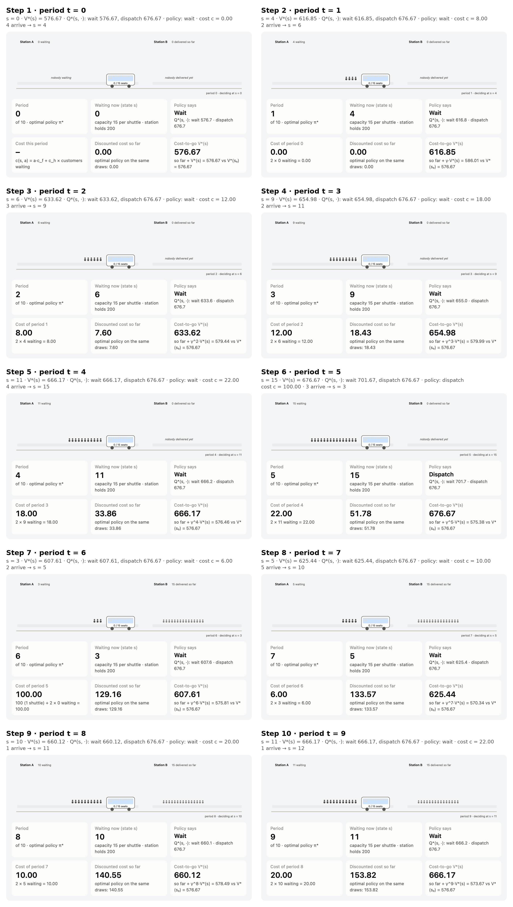

*Figure 5. Section 2, validation: the dashboard's "Explore the problem" panel at the start of each of the first 10 periods under the optimal policy (handout parameters, empty station at t = 0, the explorer's default seed): customers waiting, the policy's decision, the previous period's cost, the discounted cost so far and the cost-to-go. The label above each screenshot gives that period's state, value, Q-values, action, cost, arrivals and next state.*

### Additional validation with 3 more months

> Given an additional 3 months (extended period), what other validation tests and experiments would you perform?

- One thing I would like to do is for enumeration for us to not assume the condition that we will not incur any costs at our timestep of 500. Assuming the case where there is a terminal valye of 1 trillion for every s, then we get very super marginal changes in our value at timestep 0 (i.e. $7.27)
- Along those lines if we start fudging our original prompt by assuming new conditions few things: i.e. if we start having platform B also have people moving to Platform A, we're assuming there's an amount of people in the car existing, and it doesn't fully clear all the time at B. We will have more interesting results due to the environment being less deterministic and more random (i.e. if each person had agency as well, that would be an interesting topic to explore, i.e. if we have multiple station and stop)

## 3. Policy Gradient: Part 1 (40 points)

### Solution overview

> Using PyTorch, implement the basic policy gradient algorithm: train a simple neural network that models the policy and takes actions based on the provided states. Set the discounted reward over an episode as your objective function and use Adam as your gradient optimizer with learning rate 0.01 (if you use a different learning rate because training is more stable, mention it). Provide a description of your solution and any corresponding plots.

So moving from Value & policy Iteration to policy gradient has one major change: so we're moving from a DP problem to a neural network to perform back prop. Since we don't know the transition probabilities, we can only run the simulation in order for us to tell. 
Using FFNN techniques, we'll implement our network and use Gradient ascent (given maximization) using the Adam optimizer.  

Markov Decision Process means 5 things we should define: 1. state 2. action 3. transition 4. cost and 5. objective Reward

1. State: CartPole the state is 4 numbers, for pong the state is 
2. Action: Action space is 2, Discrete(2); for pong the action space is Discrete(6): No operation, Fire, Right, Left, Rightfire, Leftfire, the agent will only choose between two, right or left so instead it would be Discrete(2)  
3. Transition: We are not given the transition due to the high dimensionality of the space I'm assuming 
4/5. Cost/obj: Cost in this case is reward as our objective is "win the game" or get the most amount of points at each time step so max(reward_t)

### (a) CartPole-v1, discount factor 0.95

> Plot the episode reward against the number of training episodes, overlaid with the moving average of the rewards over 100 episodes. When you finish training, roll out 500 episodes using your trained model. Plot the histogram of the 500 episode rewards and report the mean and the standard deviation.

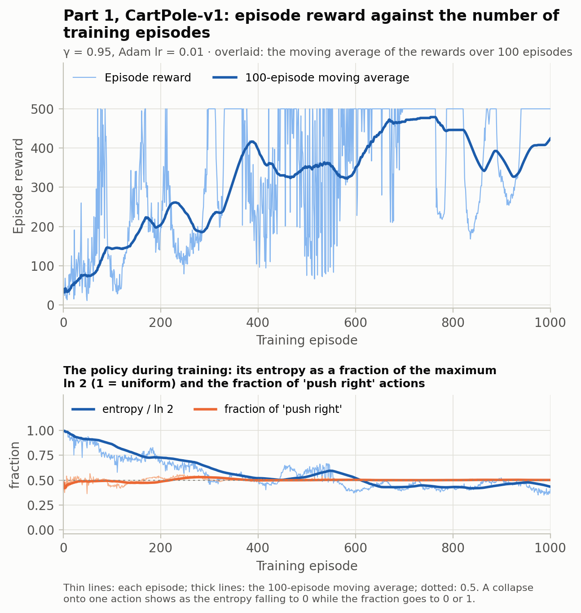

*Figure 6. Part 1 (a), CartPole-v1: the episode reward against the number of training episodes, overlaid with the moving average of the rewards over 100 episodes. The lower panel shows the policy itself per episode: its entropy and the fraction of push-right actions.*

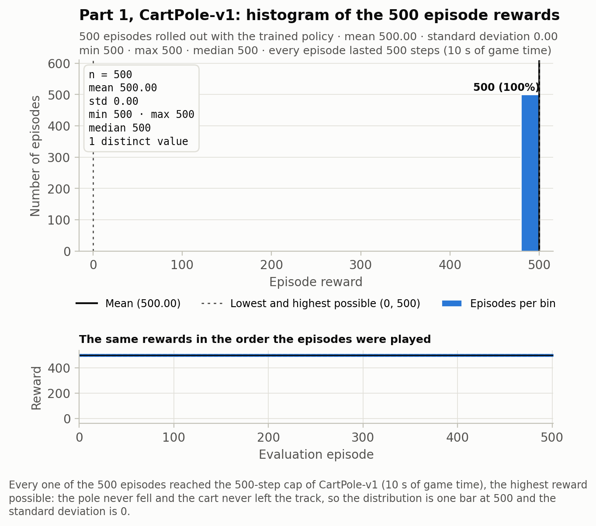

*Figure 7. Part 1 (a), CartPole-v1: histogram of the 500 episode rewards (500 episodes rolled out with the trained policy), with the mean and the standard deviation (also the minimum, maximum and median), over the whole range of rewards the game allows; below it, the same 500 rewards in the order the episodes were played.*

**Evaluation over 500 episodes:** mean reward = 500.00, standard deviation = 0.00.

Learning rate being 0.01 seems to be really high, and there's instability in our training. With a standard deviation of 0 and having 500 seems to be a suspicious result, and could use further probing in the future. It seems to have learned the optimal policy however, seeing the part 1 histogram on the right we seemed to have converged on our episode rewards through our policy, and for entropy being at 50% tells us were like 90% sure of the correct actions we need to do

### (b) Pong-v5, discount factor 0.99

> Use frames of the game as input to a neural net which models the policy. The game has six actions [NOOP, FIRE, RIGHT, LEFT, RIGHTFIRE, LEFTFIRE], but you should train a network that chooses the best action only between [RIGHT, LEFT] (actions 2 and 3). You may pre-process the frames with the provided preprocess function. Use the specified environment version (Pong-v5); on deepdish, use a single GPU card. Plot the episode reward against the number of training episodes, overlaid with the moving average of the rewards over 100 episodes. When you finish training, roll out 500 episodes using your trained model. Plot the histogram of the 500 episode rewards and report the mean and the standard deviation.

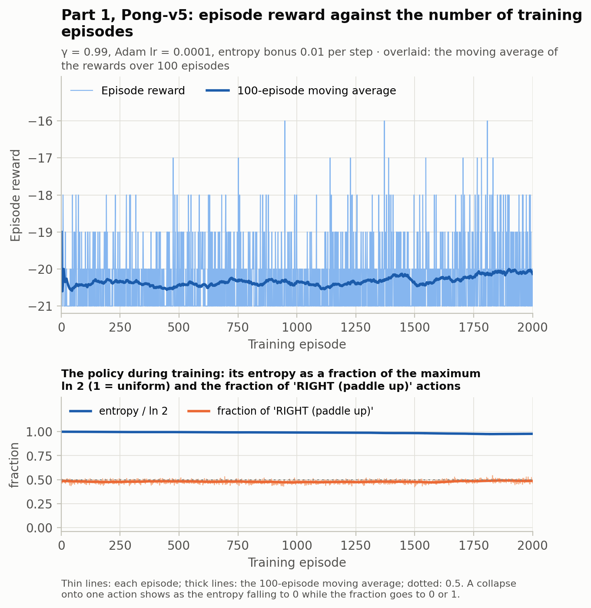

*Figure 8. Part 1 (b), Pong-v5: the episode reward against the number of training episodes, overlaid with the moving average of the rewards over 100 episodes. The lower panel shows the policy itself per episode: its entropy and the fraction of RIGHT actions, where a collapse onto one action would show. Trained with Adam at learning rate 10⁻⁴ instead of the handout's 0.01, plus an entropy bonus of 0.01 per step: with 0.01 and no bonus the policy collapsed onto a single action within about 150 episodes and lost every game 0 : 21 (results/pg/part1_pong_lr0.01).*

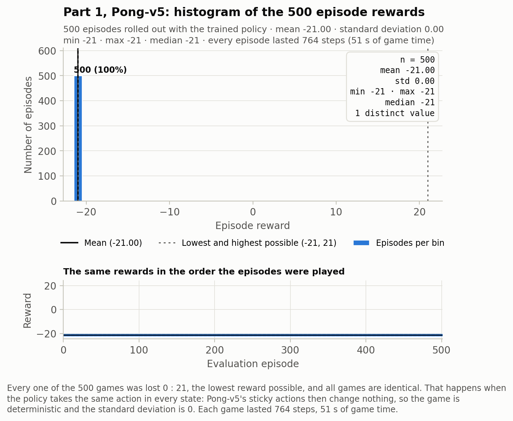

*Figure 9. Part 1 (b), Pong-v5: histogram of the 500 episode rewards (500 episodes rolled out with the trained policy), with the mean and the standard deviation (also the minimum, maximum and median), over the whole range of rewards the game allows; below it, the same 500 rewards in the order the episodes were played.*

**Evaluation over 500 episodes:** mean reward = -20.09, standard deviation = 0.98.

I fixed an issue where the gradient just collapsed by introducing entropy and encouraging the model to not just rely on one action, that being said it seems liek the policy is still kind of random, it seems like the entropy stayed at around 1 the entire time (and ended at 0.98), which does just tell us it's a coin flip whether we do the right action for the optimal policy. But that being said it seems like Right and Left is still chosen at around half of the time, which is better than our entire gradient collapsing, and us just choosing one action to do. 

I believe to solve the pong problem we need to introduce more features to the RL model- specifically some sort of time based encoding value or some sort of way for us to track the velocity of the ball at the position it was in.

### Edge cases

> What edge cases may arise from the problem and how did you handle them? Document the edge cases of the problem that you considered and explain how you ensured that your solution has handled them correctly.

- To prevent the gradient collapsing for Pong (i.e. we had the gradient collapse, and to solve that, we lowered learning rate to 1e-4, added the entropy bonus so policy doesn't pick only 1 action and stops trying out the other action and tries out the other actions, additionally logging so we can see where the collapse is as well. 
-

### Tests for validating the correctness of your algorithm

> Beyond asking AI, how do you know that your algorithm is working correctly? Test whether your implementation is behaving as predicted. For example, you may change certain parameters or the structure of the problem and see if the output matches your expectation. You may also reduce the stochasticity of the environment or policy so that the process is close to deterministic. You may also find it useful to isolate the first 10 steps and observe how the states, values, rewards, and policy interact at each step. Provide directions and documentation for how to execute validation and test experiments (what does each test do, how does it validate, etc). Provide quantitative and convincing evidence. (Not unit tests or basic bug fixes, such as checking the data format.)

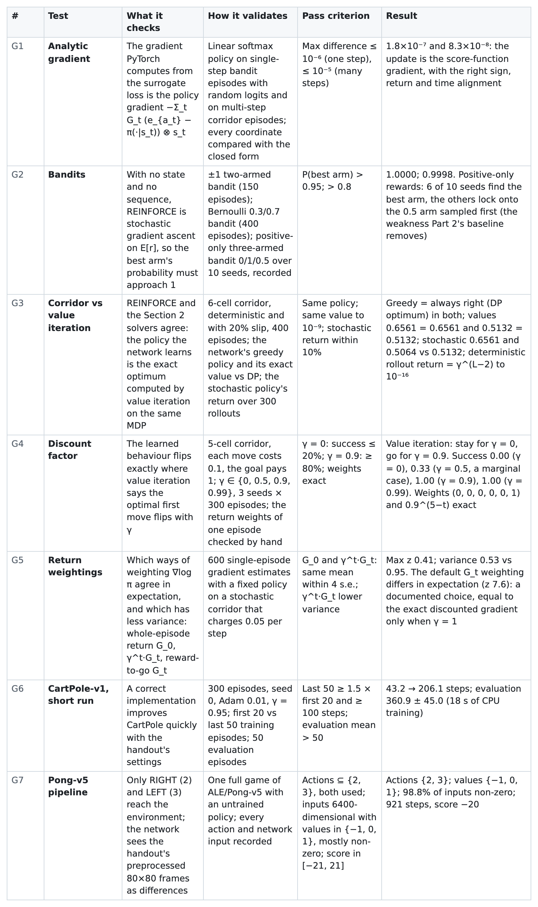

*Figure 10. Policy Gradient Part 1, validation: summary of the validation experiments G1–G7, with what each one checks, how it validates the algorithm, its pass criterion and the result observed (the table in report/pg1_tests_table.md). The harness's detailed results for each experiment follow.*

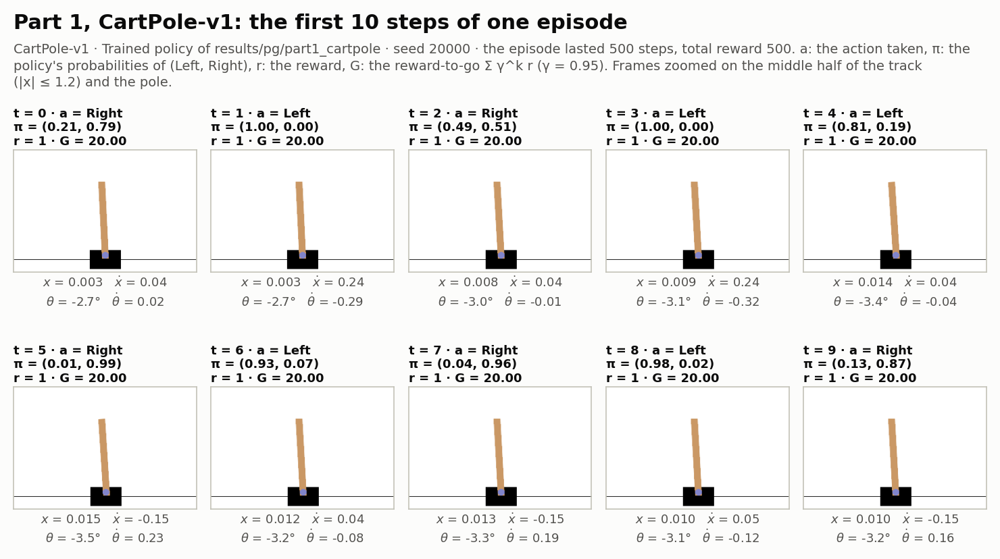

*Figure 11. Part 1 (a), CartPole-v1: the first 10 steps of one episode played by the trained policy, with the action taken, the policy's probabilities, the reward and the reward-to-go at each step (the dashboard's "Watch the game" panel replays the whole episode).*

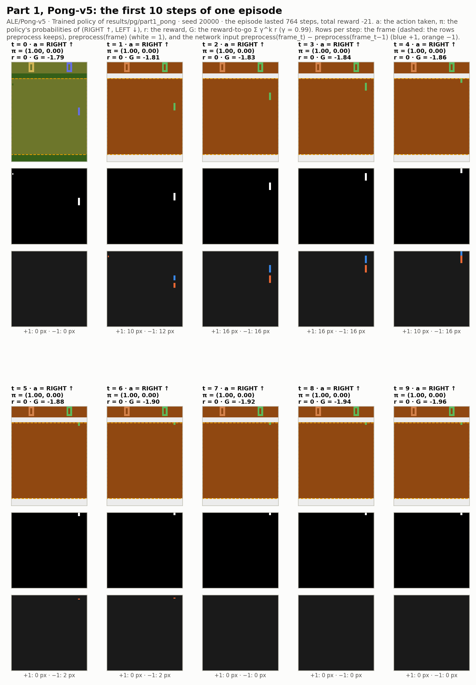

*Figure 12. Part 1 (b), Pong-v5: the first 10 steps of one episode played by the trained policy, with the action taken, the policy's probabilities, the reward and the reward-to-go at each step: the frame the environment gives, what the handout's preprocess function makes of it, and the frame difference the network receives (the dashboard's "Watch the game" panel replays the whole episode).*

Validation results from `python run.py tests --section pg1` (last run 2026-10-26 12:35:40 on mlds-deepdish2):

| Test | What it does | How it validates | Result |
|---|---|---|---|
| The implemented gradient equals the analytic policy gradient | For a linear softmax policy, compares the gradient PyTorch computes from the surrogate loss with the closed form −Σ_t G_t (e_{a_t} − π(·\|s_t)) ⊗ s_t, on single-step bandit episodes with random logits and on multi-step corridor episodes. | REINFORCE's update is Σ_t ∇log π(a_t\|s_t) G_t and the score of a softmax is e_a − π, so the two must agree to floating-point precision for every action and return; a sign error, a missing return, or a wrong time alignment would show up immediately. | PASSED (2/2 checks) |
| Bandits: the policy concentrates on the better arm | Trains the policy on one-step problems: a deterministic two-armed bandit with rewards −1 and +1, a Bernoulli bandit with success probabilities 0.3 and 0.7, and a three-armed bandit with positive rewards 0, 1 and 0.5 (10 seeds). | Without state or sequence effects, REINFORCE is plain stochastic gradient ascent on E[r], so the probability of the best arm must approach 1 in the first two problems. The third problem documents a known weakness that motivates Part 2: with positive-only rewards and no baseline, every sampled arm is reinforced, so some seeds lock onto the 0.5 arm sampled early; the fraction that still finds the best arm is recorded (and compared with baselines in the Part 2 experiments). | PASSED (2/2 checks) |
| REINFORCE reaches the optimum computed by value iteration (corridor) | A corridor of 6 cells with the reward at the end (deterministic, and with a 20% chance that a move is reversed). The exact optimal policy and value come from the Section 2 solvers on the same MDP; REINFORCE is trained for 400 episodes and its greedy policy is evaluated exactly on the MDP. | Two independent implementations must agree: the greedy policy extracted from the trained network must be 'always right' (the DP optimum), its exact value must equal the DP optimal value, and in the deterministic case the discounted return of a greedy rollout must be γ^(L−2) exactly. The stochastic policy's own average return must be close to the optimum once the per-state probabilities of 'right' are near 1. | PASSED (7/7 checks) |
| The discount factor decides whether a delayed reward is worth pursuing | A 5-cell corridor where every move to the right costs 0.1 and the goal pays 1. For γ ∈ {0, 0.5, 0.9, 0.99} the Section 2 solvers give the exact optimal policy of the corresponding MDP (go right from the start or not), and REINFORCE is trained with the same γ (3 seeds, 300 episodes); the success rate at the end of training is compared with what the optimal policy does. Also checks the return weights of one episode. | With γ = 0 only the immediate reward counts, so moving right (−0.1) is never worth it and the optimal agent stays at the start; with γ = 0.9 the discounted goal reward outweighs the move costs. Value iteration says exactly which γ flip the decision, and REINFORCE trained with each γ must reproduce that decision: near-zero success where the optimum is to stay, near-certain success where it is to go. This isolates the discount factor from every other part of the algorithm. | PASSED (4/4 checks) |
| Three ways to weight the log-probabilities: which agree in expectation | With a fixed random policy on a stochastic corridor that charges 0.05 per step (so rewards arrive at every step, not only at the goal), draws 600 single-episode gradient estimates for three weightings of ∇log π(a_t\|s_t): the whole-episode return G_0 (classic REINFORCE), γ^t·G_t (the exact gradient of the discounted objective, `--set discount_grad=true`) and the reward-to-go G_t without the γ^t factor (the implementation's default, as in most practical code), and compares means and variances. | Rewards earned before step t are independent of a_t given the history, so dropping them does not change the expectation: the G_0 and γ^t·G_t estimates must have the same mean within sampling error, and here the γ^t·G_t weights are pointwise smaller, so its variance must be lower. The default G_t weighting drops the γ^t factor and therefore estimates a slightly different gradient (it treats every visited state as a start state); the experiment records that difference so the choice is a documented one. | PASSED (2/2 checks) |
| CartPole-v1 learns within 200 episodes on the CPU | Trains with the handout's settings (Adam, learning rate 0.01, γ = 0.95) for 300 episodes, seed 0, then evaluates 50 episodes; records the mean reward of the first 20 and of the last 50 training episodes. | A correct REINFORCE implementation improves CartPole quickly: the last 50 episodes must average at least 1.5 times the first 20 and at least 100 steps, and the evaluation mean must exceed 50 (random play lasts about 22). The full 1000-episode run and its plots are produced by `python run.py pg --part 1 --env cartpole`. | PASSED (2/2 checks) |
| Pong-v5 pipeline: preprocessing and the two-action restriction | Plays one full game of ALE/Pong-v5 with an untrained policy, recording every action sent to the environment and statistics of the preprocessed frame differences the network sees. | The handout restricts the agent to RIGHT (2) and LEFT (3): every recorded action must be one of them. The preprocessed input must be an 80×80 image with values in {−1, 0, 1} (frame difference of binary frames) that is non-zero most of the time (the ball and paddles move), and a game must end with a score between −21 and 21 (an untrained agent loses almost every point). | PASSED (5/5 checks) |

- **The implemented gradient equals the analytic policy gradient**: max |autograd − analytic| (multi-step) = 8.277e-08
- **Bandits: the policy concentrates on the better arm**: P(best arm), rewards ±1 = 1, P(best arm), Bernoulli 0.3/0.7 = 0.9998, positive-only rewards: seeds finding the best arm (of 10) = 6
- **REINFORCE reaches the optimum computed by value iteration (corridor)**: optimal value (slip 0.0) = 0.6561, optimal value (slip 0.2) = 0.5132
- **The discount factor decides whether a delayed reward is worth pursuing**: success rate (γ = 0.0) = 0, success rate (γ = 0.5) = 0.3333, success rate (γ = 0.9) = 1, success rate (γ = 0.99) = 1
- **Three ways to weight the log-probabilities: which agree in expectation**: max |z|: G_0 vs γ^t G_t = 0.415, max |z|: G_0 vs G_t = 7.645, variance ratio γ^t G_t / G_0 = 0.5559
- **CartPole-v1 learns within 200 episodes on the CPU**: mean reward, episodes 1-20 = 43.2, mean reward, episodes 251-300 = 206.1, evaluation mean (50 episodes) = 360.9, evaluation std = 44.99, training time (s) = 18.3
- **Pong-v5 pipeline: preprocessing and the two-action restriction**: steps in the game = 921, game score (reward sum) = -20, fraction of frame differences with any non-zero pixel = 0.9881, seconds per step (CPU, untrained MLP) = 0.001

An example is we ran the cartpole's first 10 and evaluated that the math made sense. Additionally we added some validation tests that can help verify if the policy was accurate.

### Additional validation with 3 more months

> Given an additional 3 months (extended period), what other validation tests and experiments would you perform?

- One of the points mentioned above is that it is quite suspicious that for 500 episodes we managed to converge on the maximum reward the entire time (aka for 10 seconds). I would test on increasing the amount of time this is ran- in addition to modifying the parameters so we could have more interesting results (i.e. making the system more complex so we learn a more interesting policy)
- Adjusting our learning rate potentially could help (0.01) we could change it to a lower number
- Learning rate of 0.01 completely went right when we trained the pong with it, and we had to change the learning rate to 0.0001. Additionally the training period could be extended, and that would also allow our system to perform better as it will have more data to train on (or we can do some sort of batch training as well)

## Policy Gradient: Part 2 (20 points)

### Baseline: choice and implementation

> The training suffers from high variance of the rewards in the sampled episodes; using a baseline helps to reduce the variance. Repeat the experiments of Part 1 using a constant or non-constant baseline of your choice. Explain which baseline you have chosen and how you implemented it.

Which baseline to choose: I choose a learned state-value baseline, which essentially is another network that we use to help us predict the discounted returns. This is better than constant baselines such as the average return, mostly because constants cannot tell the difference between the states, so with this network we then can create a policy gradient that can have different variation amoung states. The network is similar to the policy's architecture, but it has one output instead of one per action. It has its own weights as its own Adam optimizer with a learning rate of 0.01. it is able to enter the policy gradient by the difference which is how we calculate the loss

### Solution overview

> Provide a description of your solution and any corresponding plots.

Baseline allows us to determine which actions we should take the loss on, so with the baseline we can then adjust the specific weights instead of updating the entire gradient. As we see from the part 2's test of the Cartpole, we were able to reduce the variance and introduce stability with the baseline. If we compare without baseline and with baseline, we can see that for training, we converge on the training dataset much faster in comparison to part 1- we reached the maximum reward at about 650 ish episodes.

### (a) CartPole-v1 with baseline

> Repeat Part 1 (a) with your baseline. Plot the episode reward against the number of training episodes, overlaid with the moving average of the rewards over 100 episodes. When you finish training, roll out 500 episodes using your trained model. Plot the histogram of the 500 episode rewards and report the mean and the standard deviation.

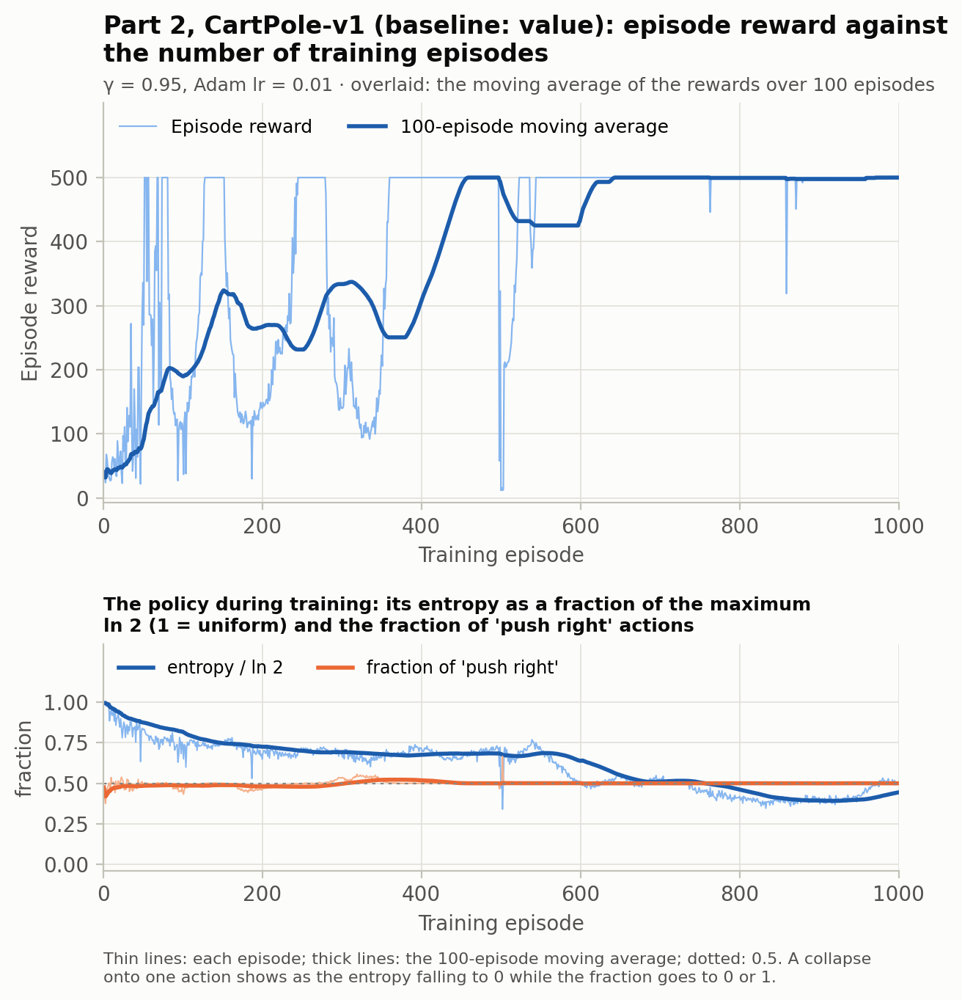

*Figure 13. Part 2 (a), CartPole-v1: the episode reward against the number of training episodes, overlaid with the moving average of the rewards over 100 episodes. The lower panel shows the policy itself per episode: its entropy and the fraction of push-right actions.*

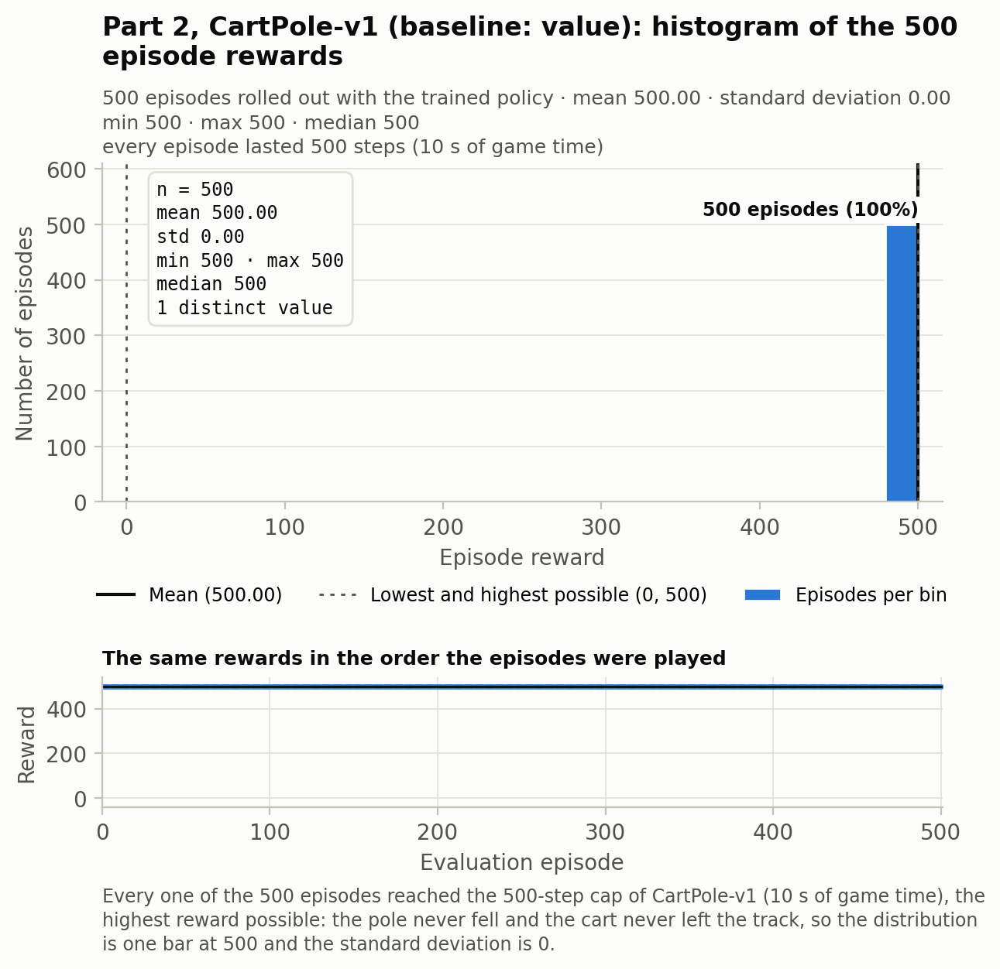

*Figure 14. Part 2 (a), CartPole-v1: histogram of the 500 episode rewards (500 episodes rolled out with the trained policy), with the mean and the standard deviation (also the minimum, maximum and median), over the whole range of rewards the game allows; below it, the same 500 rewards in the order the episodes were played.*

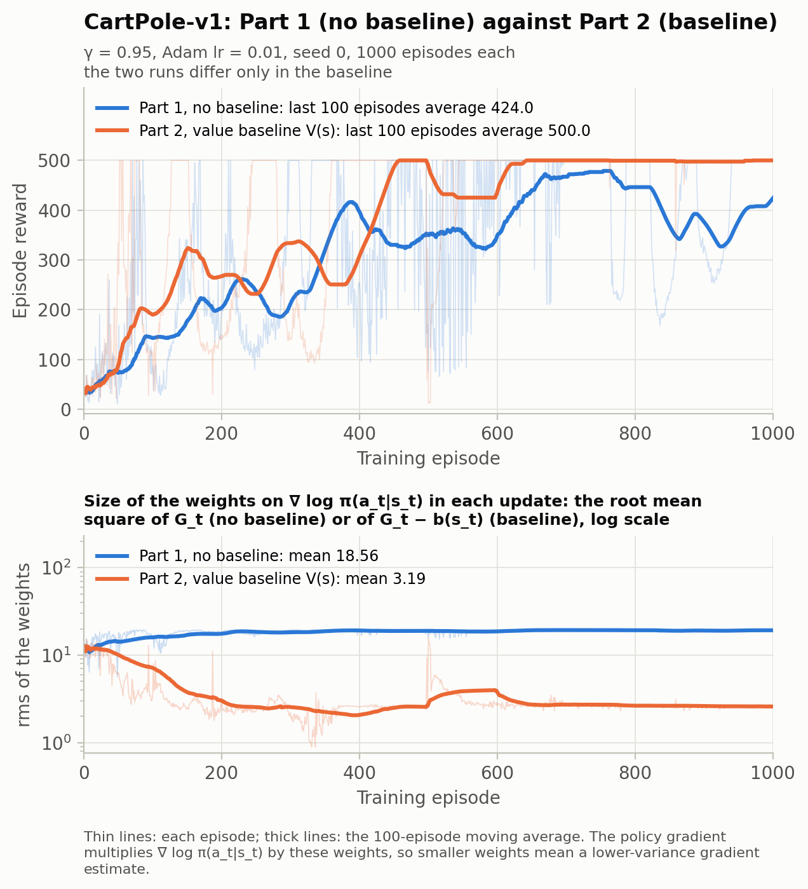

*Figure 15. Part 2 (a), CartPole-v1: the Part 1 run (no baseline) against the Part 2 run (value baseline V(s)), with the same seed, learning rate and discount factor. Top: the episode rewards and their 100-episode moving averages. Bottom: the root mean square of the weights that multiply ∇ log π(a_t|s_t) in each update, G_t without the baseline and G_t − V(s_t) with it (log scale); the lower the line, the smaller the variance of the gradient estimate, which is what the baseline is for.*

**Evaluation over 500 episodes:** mean reward = 500.00, standard deviation = 0.00.

From episodes 0-400 we can still see the model is training itself, but as we approach around 500-600 we slowly converged into the current policy. bottom left corner is our entropy which as we can see eventually intersects with our amount of "push right" actions. Generally speaking this is good, as  our entropy doesnt collapse to 0, and we're not choosing 1 policy over another policy all the time (and have zeroing out gradients)

### (b) Pong-v5 with baseline

> Repeat Part 1 (b) with your baseline. Plot the episode reward against the number of training episodes, overlaid with the moving average of the rewards over 100 episodes. When you finish training, roll out 500 episodes using your trained model. Plot the histogram of the 500 episode rewards and report the mean and the standard deviation.

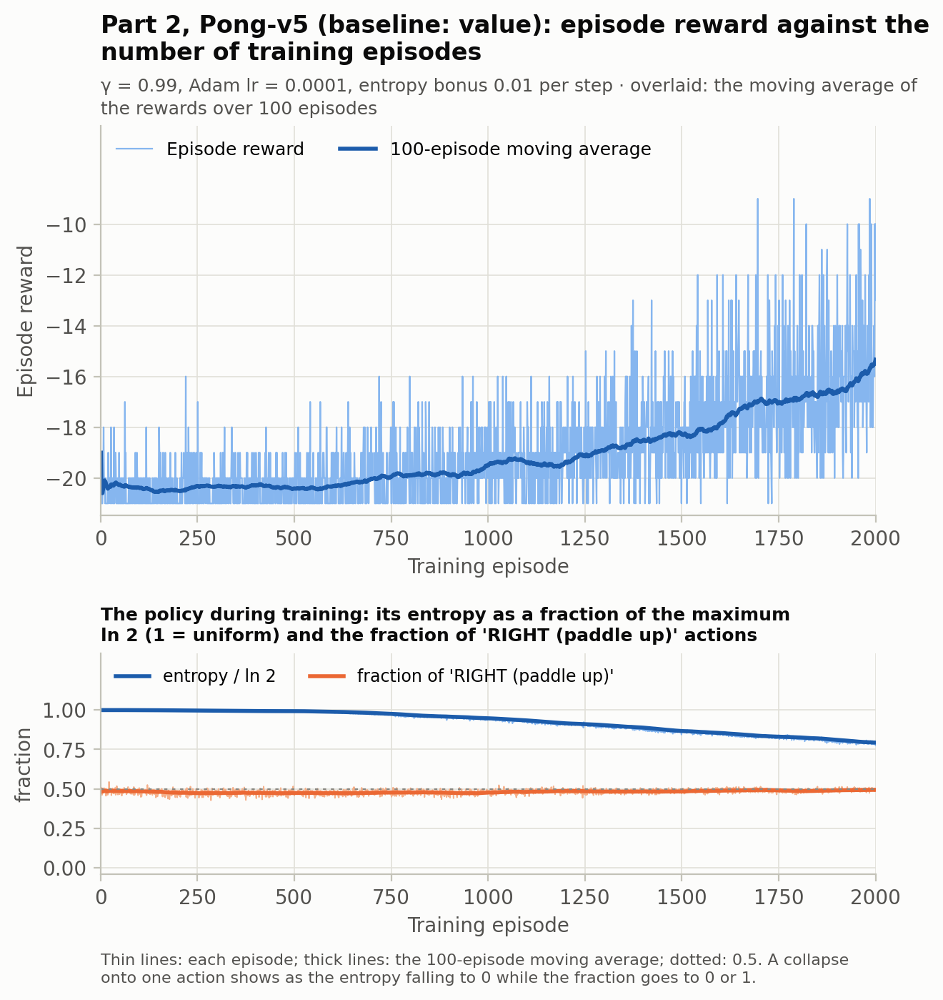

*Figure 16. Part 2 (b), Pong-v5: the episode reward against the number of training episodes, overlaid with the moving average of the rewards over 100 episodes. The lower panel shows the policy itself per episode: its entropy and the fraction of RIGHT actions, where a collapse onto one action would show. Trained with Adam at learning rate 10⁻⁴ instead of the handout's 0.01, plus an entropy bonus of 0.01 per step: with 0.01 and no bonus the policy collapsed onto a single action within about 150 episodes and lost every game 0 : 21 (results/pg/part1_pong_lr0.01).*

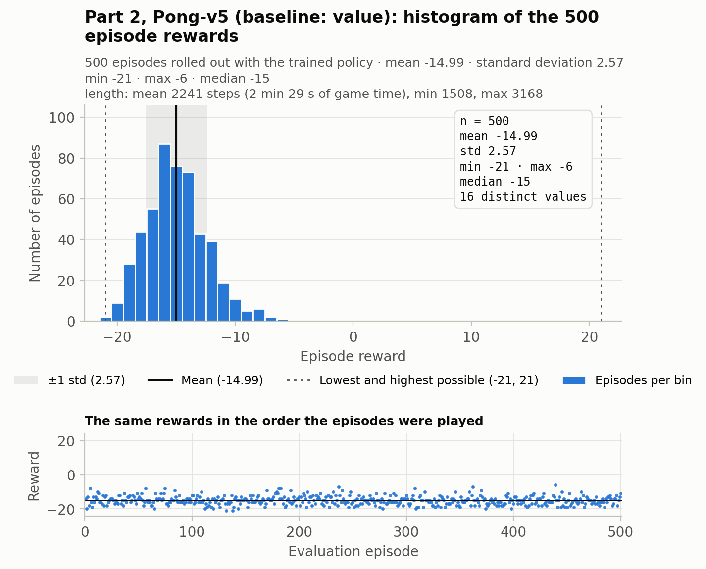

*Figure 17. Part 2 (b), Pong-v5: histogram of the 500 episode rewards (500 episodes rolled out with the trained policy), with the mean and the standard deviation (also the minimum, maximum and median), over the whole range of rewards the game allows; below it, the same 500 rewards in the order the episodes were played.*

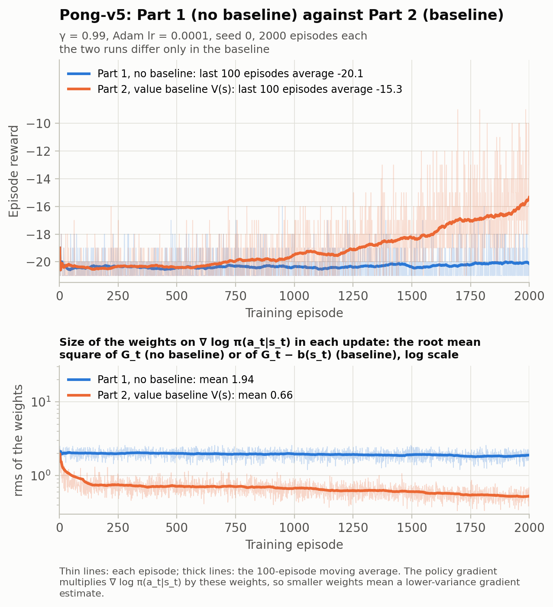

*Figure 18. Part 2 (b), Pong-v5: the Part 1 run (no baseline) against the Part 2 run (value baseline V(s)), with the same seed, learning rate and discount factor. Top: the episode rewards and their 100-episode moving averages. Bottom: the root mean square of the weights that multiply ∇ log π(a_t|s_t) in each update, G_t without the baseline and G_t − V(s_t) with it (log scale); the lower the line, the smaller the variance of the gradient estimate, which is what the baseline is for.*

**Evaluation over 500 episodes:** mean reward = -14.99, standard deviation = 2.57.

Similar to Part 1, Pong-v5 uses Adam at 10⁻⁴ with an entropy bonus of 0.01 per step, because the handout's 0.01 collapsed the policy onto one action. As we can see from the histogram, we also seem to have better rewards in comparison to our non-baseline version. 

Additionally looking at the provided filter, the network is not looking at the ball at all- so even just more information in that regards would probably help the algorithm a lot in predicting where its paddle needs to be. At the current moment its predicting where the paddle will be in any amount of time (aka it's trying to learn the relationship of the enemy's paddle in regards to the ball). And the reason why it's improving is because there is a relationship between how the enemy is currently moving with how the ball is being passed to us. With enough epochs we will be able to learn this relationship for sure. 
In our Pong run with the value baseline, we had an evaluation mean of around -14, which is better than our prior -21 (the collapsed non baseline version) mean. We can see that it did learn, and scored around 6 points per game on average, and on its best game up to 15 points

### Edge cases

> What edge cases may arise from the problem and how did you handle them? Document the edge cases of the problem that you considered and explain how you ensured that your solution has handled them correctly.

- it is possible that in our random initialization for our neural network for baseline, for it to create a induction bias that is really really bad, and that could potentially cause some problems within training. We address this by the lean proof baseline_unbiased covers this 
- We would have an issue if the baseline depends on the action, however we only take the state as our input and not the action itself (as stated in the first statement) 
- One thing I am curious about as well is if our model would eventually learn some sort of action where if it continuously moved the paddle up and down the chances of it hitting the ball would be pretty high. At this current point in time it is hard to tell, but we can potentially address this by providing some temporal encoding which we are not currently doing.

### Tests for validating the correctness of your algorithm

> Beyond asking AI, how do you know that your algorithm is working correctly? Test whether your implementation is behaving as predicted. For example, you may change certain parameters or the structure of the problem and see if the output matches your expectation. You may also reduce the stochasticity of the environment or policy so that the process is close to deterministic. You may also find it useful to isolate the first 10 steps and observe how the states, values, rewards, and policy interact at each step. Provide directions and documentation for how to execute validation and test experiments (what does each test do, how does it validate, etc). Provide quantitative and convincing evidence. (Not unit tests or basic bug fixes, such as checking the data format.)

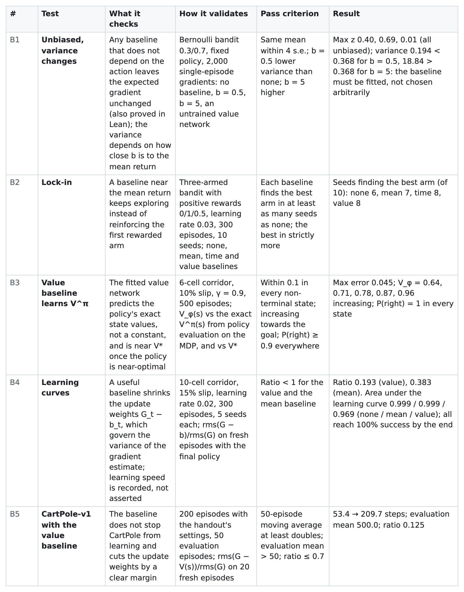

*Figure 19. Policy Gradient Part 2, validation: summary of the validation experiments B1–B5, with what each one checks, how it validates the baseline, its pass criterion and the result observed (the table in report/pg2_tests_table.md). The harness's detailed results for each experiment follow.*

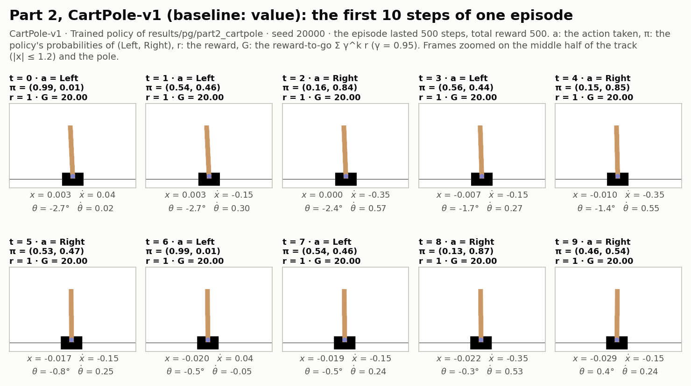

*Figure 20. Part 2 (a), CartPole-v1: the first 10 steps of one episode played by the trained policy, with the action taken, the policy's probabilities, the reward and the reward-to-go at each step (the dashboard's "Watch the game" panel replays the whole episode).*

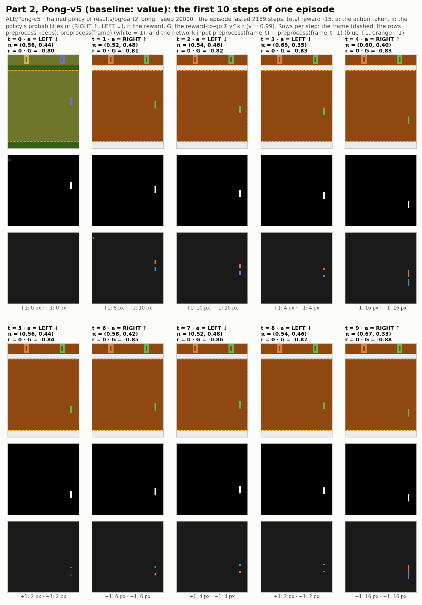

*Figure 21. Part 2 (b), Pong-v5: the first 10 steps of one episode played by the trained policy, with the action taken, the policy's probabilities, the reward and the reward-to-go at each step: the frame the environment gives, what the handout's preprocess function makes of it, and the frame difference the network receives (the dashboard's "Watch the game" panel replays the whole episode).*

Validation results from `python run.py tests --section pg2` (last run 2026-10-26 12:37:04 on mlds-deepdish2):

| Test | What it does | How it validates | Result |
|---|---|---|---|
| A baseline leaves the expected gradient unchanged and changes its variance | On a Bernoulli bandit (success probabilities 0.3 and 0.7) with a fixed policy, draws 2000 single-episode gradient estimates with no baseline, with the constant baseline b = 0.5 (the mean reward), with a deliberately bad constant b = 5, and with an untrained value network, and compares their means and variances. | Any baseline that does not depend on the action keeps the estimator unbiased (Lean: baseline_unbiased), so all four means must agree within sampling error. The variance is minimised near the mean return: b = 0.5 must have lower variance than no baseline, and b = 5 a much higher one, which is why the baseline has to be fitted rather than chosen arbitrarily. | PASSED (5/5 checks) |
| Baselines prevent lock-in on the first rewarded arm | Three-armed bandit with positive rewards 0, 1 and 0.5, learning rate 0.03, 300 episodes, 10 seeds, trained without a baseline and with the mean, time and value baselines; counts the seeds whose final policy prefers the best arm. | Without a baseline every sampled arm is reinforced (all returns are positive), so Adam can lock onto the 0.5 arm before the 1.0 arm is ever tried. A baseline near the average return makes the 0.5 arm's advantage zero or negative, so the policy keeps exploring until it finds the 1.0 arm: the baselines must find the best arm at least as often as plain REINFORCE. | PASSED (3/3 checks) |
| The value baseline learns the policy's state values | Trains REINFORCE with the value baseline on a 6-cell corridor (10% slip, γ = 0.9) for 500 episodes, then compares the value network's prediction in every state with the exact value of the learned stochastic policy (computed by policy evaluation on the corridor MDP) and with the optimal value. | The baseline network is fitted by least squares to the observed returns, whose expectation is the value of the current policy, so V_φ(s) must be close to V^π(s) in the states the policy visits (within 0.1 on a 0-1 scale) and must increase towards the goal. Because the policy is near-optimal by the end, V_φ is also close to V*. This checks that the baseline is state-dependent and informative, not a constant. | PASSED (3/3 checks) |
| Learning curves with and without a baseline | A 10-cell corridor with 15% slip, learning rate 0.02, 300 episodes, 5 seeds each for no baseline, the mean baseline and the value baseline; records the average success rate over training (area under the learning curve), the final success rate, and the root-mean-square of the per-step weights (G_t − b_t) relative to that of G_t, measured on fresh episodes with the final policy and baseline. | The variance of the gradient estimate scales with E[(G_t − b_t)²], so a useful baseline must shrink the root-mean-square weight (a constant baseline cannot change the standard deviation of the weights, only their mean square). Whether lower-variance updates also learn faster depends on the problem, so the areas under the learning curves are recorded and compared rather than asserted: on this sparse-reward corridor the only reward is a success, so plain REINFORCE's habit of reinforcing every success is not a handicap, while the value baseline first has to learn the values it subtracts. | PASSED (2/2 checks) |
| CartPole-v1 with the value baseline (200 episodes on the CPU) | Trains CartPole-v1 for 200 episodes with the value baseline (handout settings otherwise), evaluates 50 episodes, and measures on 20 fresh episodes how much the baseline shrinks the update weights (root-mean-square of G_t − V(s_t) relative to G_t). | The baseline must not stop CartPole from learning (moving average at least doubles, evaluation mean > 50) and must shrink the root-mean-square weight, which governs the variance of the gradient estimate, by a clear margin. The full 1000-episode run is `python run.py pg --part 2 --env cartpole`. | PASSED (3/3 checks) |

- **A baseline leaves the expected gradient unchanged and changes its variance**: variance ratio (b = 0.5) / none = 0.5266, variance ratio (b = 5) / none = 51.23
- **Baselines prevent lock-in on the first rewarded arm**: seeds finding the best arm: none = 6, seeds finding the best arm: mean = 7, seeds finding the best arm: time = 8, seeds finding the best arm: value = 8
- **The value baseline learns the policy's state values**: max |V_φ − V^π| over non-terminal states = 0.04492, max |V_φ − V*| = 0.04486
- **Learning curves with and without a baseline**: area under the learning curve: none = 0.9987, area under the learning curve: mean = 0.9987, area under the learning curve: value = 0.9687
- **CartPole-v1 with the value baseline (200 episodes on the CPU)**: moving average, episodes 1-50 = 53.4, moving average, episodes 151-200 = 209.7, evaluation mean (50 episodes) = 500, rms(G − V(s)) / rms(G) on fresh episodes = 0.1249, final value loss = 5.534

1. We know that the baseline does not bias the gradient as on a two arm bandit problem, we had 2000 gradient estimate without a baseline. The good baseline halved the variance (0.368 -> 0.194) while the bad baseline raied it from 51 x (18.8). Thus this is why we should learn the baseline rather than do some grid search for it.  
2. Assuming a 3 arm bandit setup, where we have 3 different machines, the first one pulls 0.5, the second one is 1 and the third is 0 for rewrad. If the agent pulls the 0.5 lever multiple times then each pull will make it pull that one bandit more likely, until the point where it won't try the second bandit. So the question is with different runs, is it possible for us to find the best lever. Without a baseline given random seeds, we get around 6/10 runs, and with a baseline we were able to get it at around 8/10 runs- so it seems like it did improve. 
3. Imagine a situation where we have 6 cells, the agent starts at left and the rightmost has reward of 1, and each move has 0.1 chance of going the wrong way. With the baseline we were able to move towards our goal state sooner, which implies that the baseline is indeed state dependent
4. With the same example, using a constant return, we made the weights around 62% smaller, in comparison with our neural network, which brought in 81% smaller 
5. Once we add in the baseline, it performs much better than untrained. After we froze the policy and played 50 games, all of the games lasted for the full 500 steps, and thus that is how we got our 500 evaluation average.

### Additional validation with 3 more months

> Given an additional 3 months (extended period), what other validation tests and experiments would you perform?

- There is a couple of deep learning techniques we could potentially apply in this Rl case- some ideas include some form of regularization or normalization for us to encourage certain learnings. Additionally I believe we can incorporate some of the more modern LLM tasks such as the transformers and multi-head attention for us to address some of the temporal encoding issues. I think that right now our states are very much just based on the training data (which in our case is running the simulation for a period of time). But similarly to the value and policy iteration (and policy gradients) all being DP problems, tells me that there may be a possibly interesting case if we were able to reference similar cases of for example for pong, when the enemy was somewhere on the top of the screen and I was on the bottom of the screen, and when the enemy was on top of screen and I was on top of the screen, and to carry over the k,v, values over to some decoder that will transfer the answer to our specific situation. 
- As we can see it seems like the pong's reward is gradually improving over time as our training episodes increase, as well as our entropy is gradually decreasing over time, so with the baseline it is performing much better in comparison with the other- if we had more training time, I would increase the amount of time we give for the system to train and it will eventually come up with an optimal model that can play pong better than any human.
